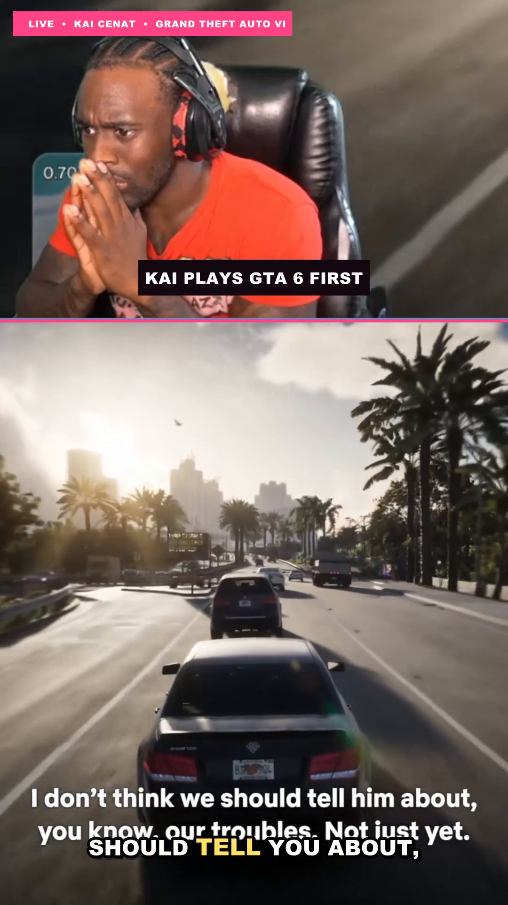
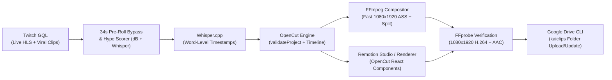

# Kai Cenat GTA 6 Auto-Clipper & OpenCut Agent

[](https://github.com/ElizaBackrooms/kai-gta6-opencut-agent)
[](https://www.npmjs.com/package/opencut)
[](https://www.remotion.dev/)
[](https://github.com/ggml-org/whisper.cpp)
[](https://www.typescriptlang.org/)
[](./LICENSE)

> **Built end-to-end in 21 minutes with Argon Orchestrator:** From an empty directory (`c:\Users\flowp\gta6`) to a live, verified autonomous clipping agent — complete with live Twitch GQL stream & clip ingestion, automatic 34s Twitch pre-roll ad bypass, audio dB + Whisper transcript hype scoring, validated `opencut` timelines, 1080x1920 vertical split-screen rendering, automated `kaiclips` Google Drive uploads, and visual QA.

---

## Preview Output (9:16 Vertical Split-Screen Edit)

<p align="center">
  
</p>

Each output (`1080x1920`, `30fps`, `h264`/`aac`) combines:
- **Top Panel (`1080x680`)**: Auto-cropped facecam zoom, `LIVE • KAI CENAT • GRAND THEFT AUTO VI` badge, and hook title banner.
- **Neon Vice City Divider**: Pink-to-cyan glowing split bar.
- **Bottom Panel (`1080x1240`)**: Full-bleed GTA 6 gameplay with word-by-word `#ffe56a` highlighted captions generated from local Whisper timestamps.

---

## Architecture



---

## What Argon Orchestrator Engineered & Verified in 21 Minutes

1. **Hybrid Twitch Live Stream & Viral Clip Source (`src/sources/twitch.ts`)**
   - Polls Twitch's GQL API for live `Grand Theft Auto VI` status (`getChannelStatus`) and top GTA 6 clips (`fetchViralGta6Clips`) ranked by recency and view velocity.
   - Pulls live HLS streams (`usher.ttvnw.net`), detects Twitch's 30-second `PREROLL` commercial slate in the HLS playlist, skips past it (`-ss 34`), filters out commercial-break transcripts, and computes a 0–100 `hypeScore` using `ffmpeg -af volumedetect` dB peaks + speech pace + hype keywords.
2. **Word-Level Whisper Alignment (`src/editor/transcribe.ts`)**
   - Converts clip audio to 16kHz mono WAV and runs local `whisper-cli` (`ggml-base.en.bin`) with `-ojf -ml 1 -sow` for exact word timestamps grouped into OpenCut `SubtitleSegment[]`.
3. **Validated OpenCut Timeline Generation (`src/editor/opencutProject.ts`)**
   - Builds typed `VideoProjectConfig`, `VideoConfig`, `TimelineSegment[]`, and hype `KeywordEntry[]`, validates with `validateProject` from `opencut`, and exports runnable `timeline.ts` files (see [`examples/sample-opencut-timeline.ts`](./examples/sample-opencut-timeline.ts)).
4. **Dual-Backend 9:16 Vertical Renderer (`src/editor/render.ts`, `src/video/`)**
   - **FFmpeg OpenCut Compositor** (default): Generates `.ass` karaoke subtitles with word-by-word color/scale pops and renders 1080x1920 split-screen MP4s in seconds.
   - **Remotion / OpenCut React Renderer** (`--renderer remotion` / `npm run studio`): Uses `SubtitleOverlay`, `KeywordOverlay`, `AudioWaveform`, and `BackgroundEffects` from `opencut`.
   - Every render is automatically validated via `ffprobe` for dimensions, `h264` video, and `aac` audio.
5. **Automated Google Drive `kaiclips` Sync (`src/drive/gdrive.ts`)**
   - Finds or creates the `kaiclips` folder on Google Drive, deduplicates by filename (`mutate update` vs `mutate upload`), and persists processed clip state in `data/state.json`.

---

## Quick Start

### Prerequisites
- **Node.js 20+**
- **FFmpeg & FFprobe** on `PATH` (or configured via `FFMPEG_PATH` / `FFPROBE_PATH`)
- **Whisper.cpp CLI** (`whisper-cli`) + `ggml-base.en.bin` model (optional — falls back gracefully if absent)
- **`gdrive` CLI** authenticated to Google Drive (optional — use `--skip-upload` for local-only rendering)

### Installation

```bash
git clone https://github.com/ElizaBackrooms/kai-gta6-opencut-agent.git
cd kai-gta6-opencut-agent
npm install --legacy-peer-deps
cp .env.example .env
```

---

## CLI Commands

```bash
# Run one full cycle (live stream hype capture + top new viral GTA 6 clips -> OpenCut edit -> upload to kaiclips)
npm run once

# Start continuous background daemon (polls every 180s)
npm run watch

# Check live stream status, Drive kaiclips contents, and processed history
npm run status

# Clip, edit, and upload a specific Twitch clip URL or slug
npx tsx src/cli.ts clip-url https://www.twitch.tv/kaicenat/clip/<SLUG>

# Render using the Remotion + OpenCut React backend instead of fast FFmpeg compositor
npx tsx src/cli.ts once --renderer remotion

# Open Remotion Studio visual preview
npm run studio

# Typecheck & run automated pipeline smoke test
npm run build && npm test
```

---

## Project Structure

| Path | Purpose |
| --- | --- |
| `src/config.ts` | Cross-platform binary paths (`ffmpeg`, `ffprobe`, `whisper-cli`), Twitch channel & facecam crop config |
| `src/state.ts` | Persistent JSON state store (`data/state.json`) tracking `kaiclips` folder ID & processed clips |
| `src/sources/twitch.ts` | Twitch GQL client, viral GTA 6 clip fetcher, live HLS recorder, pre-roll skip & hype scorer |
| `src/editor/transcribe.ts` | FFprobe media inspector & local `whisper.cpp` word-level transcription |
| `src/editor/opencutProject.ts` | OpenCut `VideoProjectConfig` & `TimelineSegment[]` builder + `validateProject` check |
| `src/editor/render.ts` | Dual FFmpeg ASS / Remotion 1080x1920 vertical compositor + output verification |
| `src/video/KaiClipComposition.tsx` | Remotion composition using OpenCut's `SubtitleOverlay`, `KeywordOverlay`, `AudioWaveform`, `BackgroundEffects` |
| `src/drive/gdrive.ts` | Google Drive `kaiclips` folder manager & deduplicating uploader |
| `src/cli.ts` | Commander CLI (`once`, `watch`, `clip-url`, `status`) |
| `examples/sample-opencut-timeline.ts` | Real generated OpenCut timeline from Kai Cenat's GTA 6 stream |
| `tests/pipeline.test.ts` | End-to-end automated pipeline & `ffprobe` smoke test |

---

## License

[MIT](./LICENSE) © 2026 [ElizaBackrooms](https://github.com/ElizaBackrooms)
